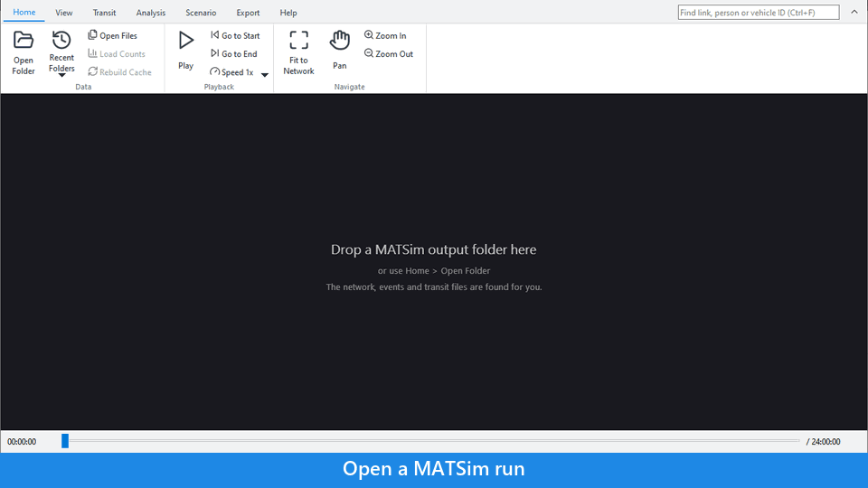

# TAREEK-Vis - Simulation Visualizer

A high-performance desktop application for visualizing MATSim simulation outputs (network and events).

<p align="center"></p>

<table align="center">
  <tr>
    <td width="50%" align="center">
      <br />
      <sub>Simulated vs. observed link volumes across a full metro-area network</sub>
    </td>
    <td width="50%" align="center">
      <br />
      <sub>Frame-accurate vehicle animation, zoomed to street level</sub>
    </td>
  </tr>
  <tr>
    <td width="50%" align="center">
      <br />
      <sub>Clicking a vehicle shows its driver's full day of trips</sub>
    </td>
    <td width="50%" align="center">
      <br />
      <sub>Tracing a selected person's route and activities on the map</sub>
    </td>
  </tr>
  <tr>
    <td width="50%" align="center">
      <br />
      <sub>Activity density along the road network, measured by driving distance</sub>
    </td>
    <td width="50%" align="center"></td>
  </tr>
</table>

## Paper

TAREEK-Vis was accepted as a demo paper at
[ACM SIGSPATIAL 2026](https://sigspatial2026.sigspatial.org/):

> Jalal Khalil, Arein Duaibes, Da Yan, and Virginia Sisiopiku. 2026.
> **TAREEK-Vis: An Interactive Visualization Tool for Large-Scale MATSim
> Traffic Simulations [Demo]**. In *Proceedings of The 34th ACM International
> Conference on Advances in Geographic Information Systems (SIGSPATIAL '26)*.
> ACM, New York, NY, USA.

📄 [Read the paper (pre-publication version)](assets/tareek_vis_sigspatial2026_demo.pdf)

This is the pre-publication version; the camera-ready copy will replace it
here once available, along with the official ACM DOI link.

## Features

- Open a MATSim run (network, events and an optional transit schedule) and
  play the vehicles over the day.
- All commands on a ribbon, with a search box and a built-in user guide (F1).
- Click a vehicle to see the trips of its driver, or the passengers of a
  transit vehicle. Show the route of a person on the map.
- Find a link, a person or a vehicle by its ID.
- Click a road to see its details and its hourly traffic volume.
- Compare simulated volumes with traffic counts.
- Show bus, tram and rail routes and stops.
- Show the density of each activity type along the road network.
- Select roads to close and export a what-if scenario file for TAREEK.
- Export the map as PNG or PDF, the hourly chart as PNG or PDF, and a video
  as MP4.
- Handles large runs (events files of 2 GB and more) with a disk cache.

## Documentation

The user guide is in [help/](help/index.md). The same guide is built into
TAREEK-Vis: press **F1**, or click **Help > User Guide**.

- [Get started](help/getting-started.md)
- [Open a simulation run](help/open-a-run.md)
- [Ribbon commands](help/ribbon.md)
- [Keyboard shortcuts and mouse](help/shortcuts.md)
- [Input files](help/input-files.md)
- [Troubleshooting](help/troubleshooting.md)
- [Privacy and security](help/privacy.md)

## Maintainer and contributions

TAREEK-Vis is maintained by [Jalal Khalil](https://jalal1.github.io/).
Contributions are welcome and encouraged: open an
[issue](https://github.com/jalal1/TAREEK-Vis/issues) or a pull request. When
you change a feature that users see, also update the help (see
[Update the help](#update-the-help-maintainers)).

## Download & Install (Windows, no build required)

1. Download `TAREEK-Vis-Setup-x.y.z.exe` from the
   [Releases page](https://github.com/jalal1/TAREEK-Vis/releases). A portable
   ZIP is also attached.
2. Run the installer. It does not need administrator rights.

For more information, see [Get started](help/getting-started.md).

## Try it with a sample run

If you do not have a MATSim run, use our sample run of Madison, Wisconsin
(about 180,000 agents, 500 MB). We made it with
[TAREEK](https://github.com/jalal1/TAREEK).

1. Download
   [tareek-vis-sample-madison.zip](https://huggingface.co/datasets/Jalalk1/tareek-vis-sample-madison/resolve/main/tareek-vis-sample-madison.zip?download=true)
   from [Hugging Face](https://huggingface.co/datasets/Jalalk1/tareek-vis-sample-madison).
2. Unzip it.
3. Drag the `tareek-vis-sample-madison` folder onto the TAREEK-Vis window.
4. Wait while TAREEK-Vis prepares the run (first time only), then press
   **Space** to play.

The folder also has a traffic counts file. To load it, see
[Get started](help/getting-started.md#try-it-with-a-sample-run).

The rest of this page is for developers.

## Requirements

- CMake 3.20+
- Qt6 (Widgets, OpenGL, OpenGLWidgets, Concurrent)
- ZLIB
- C++20 compiler (GCC 10+, Clang 12+, MSVC 2019+)
- OpenGL 3.3+ capable graphics

## Building

### Windows (MSYS2 / UCRT64 — recommended)

This is the toolchain the provided `build.bat` / `build.sh` scripts are built
for.

1. Install [MSYS2](https://www.msys2.org/), then from an MSYS2 **UCRT64**
   terminal install the dependencies:
   ```bash
   pacman -S mingw-w64-ucrt-x86_64-cmake \
             mingw-w64-ucrt-x86_64-qt6-base \
             mingw-w64-ucrt-x86_64-qt6-tools \
             mingw-w64-ucrt-x86_64-zlib
   ```
2. Build:
   ```bash
   cd path/to/TAREEK-Vis
   ./build.sh
   ```
   (or `build.bat` from a regular Command Prompt/PowerShell — it sets up the
   UCRT64 PATH itself)
3. Run: the exe needs the UCRT64 runtime DLLs on PATH, so either run it from
   an MSYS2 UCRT64 terminal, or add `C:\msys64\ucrt64\bin` to PATH first.

If you have both `mingw64` and `ucrt64` MSYS2 subsystems installed, make sure
UCRT64 comes first in PATH — mixing the two toolchains causes runtime errors
(MOC failing with exit code `0xc0000139` is the usual symptom).

### Windows (vcpkg / MSVC — untested)

Not the toolchain used by `build.bat`/`build.sh`; provided as a starting
point if you prefer MSVC, but not verified to build cleanly.

```bash
# Install dependencies
vcpkg install qt6:x64-windows zlib:x64-windows

# Configure
cmake -B build -S . -DCMAKE_TOOLCHAIN_FILE=[vcpkg-root]/scripts/buildsystems/vcpkg.cmake

# Build
cmake --build build --config Release
```

### Linux

```bash
# Install dependencies (Ubuntu/Debian)
sudo apt install qt6-base-dev qt6-opengl-dev libgl1-mesa-dev zlib1g-dev

# Configure
cmake -B build -S .

# Build
cmake --build build
```

### Releasing (maintainers)

Pushing a tag matching `v*.*.*` (e.g. `v1.0.1`) triggers
[`.github/workflows/release.yml`](.github/workflows/release.yml), which builds
the app, assembles the installer and a portable ZIP, and publishes them to a
new GitHub Release automatically:

```bash
git tag v1.0.1
git push origin v1.0.1
```

### Update the help (maintainers)

The user guide in `help/` is built into the executable. When you add or change
a feature that users see, update the help in the same change:

1. Change the topic page in `help/`, or add a new `help/<topic>.md`.
2. For a new page, add a line to `help/index.md`. That file is the table of
   contents of the help window.
3. Add new ribbon buttons to `help/ribbon.md` and new shortcuts to
   `help/shortcuts.md`.
4. Put screenshots in `help/images/`, at most 720 px wide.
5. If a new ribbon tab needs its own page for F1, add it to `pageOfTab` in
   `src/ui/main_window.cpp`.

Write short steps in plain English: one action for each step, and the
command path as **Tab > Button**. CMake finds new files in `help/` when you
build again.

## Architecture

```
TAREEK-Vis
├── Parsers         # XML → Binary preprocessing
├── Data Layer      # Network index, Chunk manager
├── Renderers       # OpenGL network/vehicle rendering
└── UI              # Qt widgets (map, timeline)
```

### Memory Management

- Network data loaded into memory with spatial indexing
- Events stored in 5-minute chunks, loaded on demand
- LRU cache for event chunks (configurable max memory)
- Binary file caching for fast subsequent loads

## License

TAREEK-Vis is licensed under the [GNU General Public License v3.0](LICENSE).

### Third-Party Libraries

| Library | License | Usage |
|---------|---------|-------|
| [Qt6](https://www.qt.io/) | LGPL v3.0 | UI framework (dynamically linked) |
| [PugiXML](https://pugixml.org/) | MIT | XML parsing (bundled) |
| [ZLIB](https://www.zlib.net/) | Zlib License | Gzip decompression |
| [FFmpeg](https://ffmpeg.org/) | LGPL/GPL | Video recording (optional, external subprocess) |
| [Lucide](https://lucide.dev/) | ISC | Ribbon icons (bundled) |

### Background Map Tiles

The optional background map layers (View → Background Map) stream raster tiles
from third-party services. TAREEK-Vis does not redistribute these tiles; they
are fetched directly by the user's machine at display time. Each service
requires attribution when its imagery is shown, reproduced, or published:

| Layer | Provider | Required attribution |
|-------|----------|----------------------|
| OpenStreetMap | [OpenStreetMap](https://www.openstreetmap.org/copyright) Standard tile layer | © OpenStreetMap contributors |
| Satellite | [Esri World Imagery](https://www.arcgis.com/home/item.html?id=10df2279f9684e4a9f6a7f08febac2a9) (ArcGIS Online) | Esri, Maxar, Earthstar Geographics, and the GIS User Community |
| Topographic | [OpenTopoMap](https://opentopomap.org/) | © OpenStreetMap contributors, © OpenTopoMap (CC-BY-SA) |

If you publish figures, screenshots, or videos produced with a background map
enabled, include the corresponding attribution in the caption or credits.
Users are responsible for complying with each provider's terms of use, which
may restrict commercial or high-volume use.

See [THIRD_PARTY_LICENSES.md](THIRD_PARTY_LICENSES.md) for full license texts.
