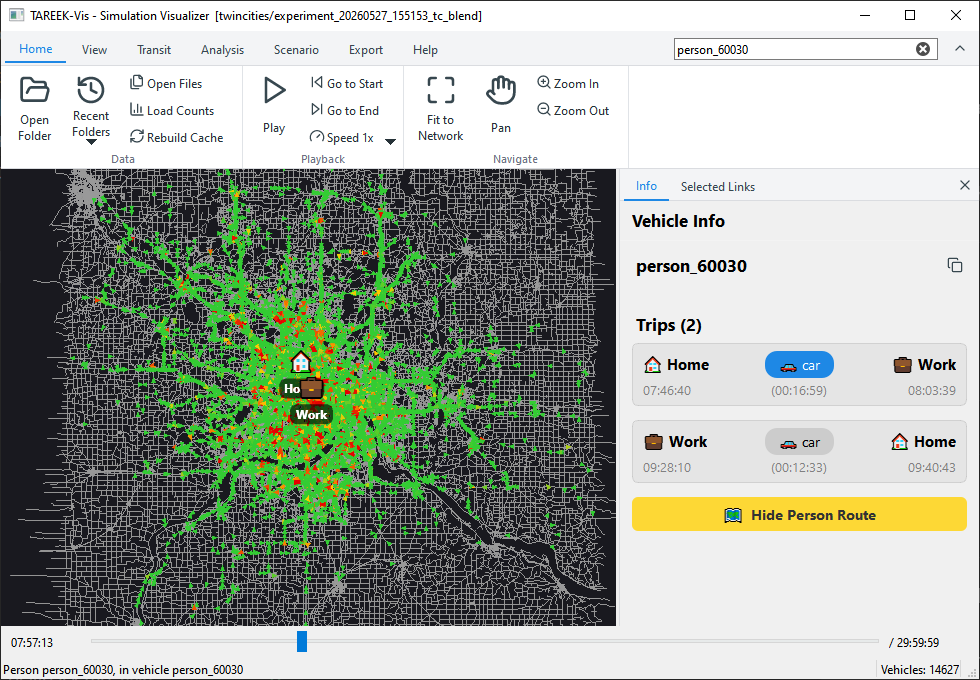
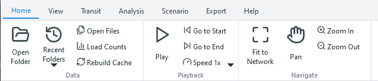

# Get started

## Install TAREEK-Vis (Windows)

1. Go to the [Releases page](https://github.com/jalal1/TAREEK-Vis/releases).
2. Download `TAREEK-Vis-Setup-x.y.z.exe` from the latest release.
3. Run the installer. It does not need administrator rights.
4. If Windows shows "Windows protected your PC", click **More info**, then
   **Run anyway**. The installer is not code-signed.

To use TAREEK-Vis without an installation, download
`TAREEK-Vis-x.y.z-portable.zip`, unzip it and run `TAREEK-Vis.exe`.

## Open your first run

1. Click **Home > Open Folder** (Ctrl+O).
2. Select the output folder of a MATSim run.
3. Wait while TAREEK-Vis prepares the run. It does this only the first time.
4. Press **Space** to play the simulation.

For more information, see [Open a simulation run](open-a-run.md).

## Parts of the window

| Part | Use |
|------|-----|
| Ribbon (top) | All the commands, in tabs. The search box is at the right of the tabs. |
| Map | The road network, the vehicles and the other layers. |
| Side panel (right) | The **Info** page shows the item that you click. The **Selected Links** page shows the links of a what-if scenario. |
| Timeline (bottom) | The simulation time. Drag the slider to go to a different time. |
| Status bar | Messages, the progress of the heatmap, and the number of vehicles on the network. |

To change the width of the side panel, drag its left edge. To close it,
click **×**.

## Use the ribbon

- Each tab has groups of buttons. For a list of all commands, see
  [Ribbon commands](ribbon.md).
- A button that turns a layer on or off has a blue background while the
  layer is on.
- Point to a button to see what it does and its shortcut.
- To get more space for the map, collapse the ribbon. Double-click a tab,
  press Ctrl+F1, or click the arrow at the right of the tabs. Then click a
  tab to use its buttons. Do the same again to expand the ribbon.

## Get help

- Press **F1** to open the help topic for the ribbon tab that is open.
- The **Help** tab has the user guide, the keyboard shortcuts, a link to
  report a problem, and the version information.
