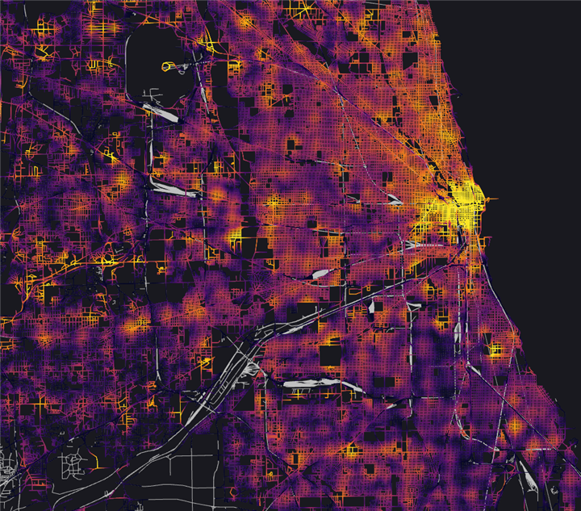

# Activity heatmap

The activity heatmap shows where the activities of one type are, for example
home or work. It shows the density along the roads. TAREEK-Vis measures the
distance along the road network, not in a straight line.

## Show a heatmap

1. Click **Analysis > Activity Heatmap**.
2. Select an activity type. The menu shows the number of activities of each
   type.

The legend is at the lower left of the map. It goes from low to high and
shows the value at the top of the scale, in activities per meter.

To remove the heatmap, click **Analysis > Activity Heatmap > Clear heatmap**.

## Compare activity types

Click **Compare types on one scale** in the heatmap menu.

- On: all maps use the same color scale. The same color means the same
  density on all of the maps.
- Off: each map uses its own highest value. This shows the pattern of one
  map, but you cannot compare two maps.

The two settings look the same until TAREEK-Vis computes a second type.

## Computation time

- After a run opens, TAREEK-Vis computes the map of each type in the
  background. The status bar shows the progress. The window stays usable.
- For networks of more than 150,000 links, TAREEK-Vis computes a map only
  when you select it. Then it asks before it starts, because this can take
  some minutes.
- TAREEK-Vis keeps each map in the cache. The next time, the map opens
  immediately.

The method is a network kernel density estimate with a 500 m bandwidth, on
road segments of 25 m. TAREEK-Vis does not include `pt interaction`
activities.
