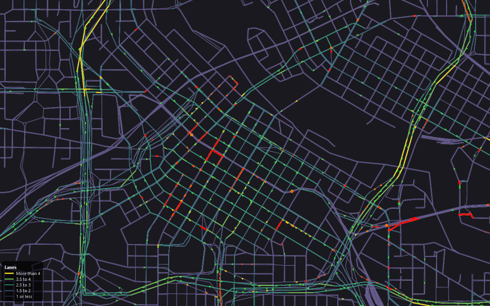

# Link colors

You can color the road links by an attribute of the network, or by a result
of the simulation that changes over the day. Use the attributes to check the
input network. Use the results to find congestion.

## Color the links

1. Open the **View** tab.
2. In the **Links** group, click **Color by**.
3. Select a color mode.

To go back to the normal map, select **Road Type**. Road Type is the default.

The **Color by** menu has these parts:

| Part | Items |
|------|-------|
| Links | Road Type |
| Links: Network | Capacity, Free Speed, Lanes, Allowed Modes |
| Links: Simulation Results | Flow, Speed / Free Speed, Delay, Density, Volume / Capacity, Delayed Vehicles |
| Sample Scale... | The sample scale of the run. See "Full population" below. |
| Vehicles | By Vehicle Speed, By Mode (Icons). See [Vehicles and persons](vehicles-and-persons.md). |

The result modes are available a short time after the run opens. TAREEK-Vis
then reads (or, the first time, makes) a table of each link in each
15-minute period of the day.

A legend at the bottom left of the map shows the classes. The legend is also
in exported PNG and PDF images. The keys at the bottom left are in one
column. From the bottom, they are:

1. The activity heatmap key, when the heatmap is on.
2. The link key, when a color mode other than Road Type is on.
3. The vehicle key, when the vehicles are on and **By Vehicle Speed** is
   selected.

## Network attributes

| Color mode | Unit | What the value is | Classes | Gray, thin |
|------------|------|-------------------|---------|------------|
| Capacity | veh/h | The capacity of the link, per hour. | 600 or less; 601 to 1,200; 1,201 to 2,000; 2,001 to 4,000; More than 4,000 | No limit (9,999 or more) |
| Free Speed | km/h | The free speed of the link. | 35 or less; 36 to 55; 56 to 75; 76 to 100; 101 to 130; More than 130 | - |
| Lanes | - | The number of lanes of the link. | 1 or less; 1.5 to 2; 2.5 to 3; 3.5 to 4; More than 4 | - |
| Allowed Modes | - | The modes that can use the link. | Car (and other modes); Bus or pt only; Rail or train; Tram or light rail; Other modes only | No modes in the network file |

- **Capacity** is per hour. The network file gives the capacity per
  capacity period (`capperiod`, usually one hour). TAREEK-Vis changes the
  value to vehicles per hour. If the network has no capacity period, the
  legend tells you, and the map shows the values of the file.
- **Allowed Modes**: a link that allows cars is in the first class, also
  when buses can use it. Most roads allow cars and buses.

## Simulation results

| Color mode | Unit | What the value is | Classes | Gray, thin |
|------------|------|-------------------|---------|------------|
| Flow | veh/h | Vehicles that enter the link, per hour. Scaled to the full population. | 5 equal classes up to the 98th percentile of the day | No vehicles |
| Speed / Free Speed | - | Free-flow time / mean travel time of the vehicles that entered. | 25 % or less; 26 to 50 %; 51 to 75 %; 76 to 90 %; More than 90 % | No vehicles entered |
| Delay | s per vehicle | Mean travel time minus the free-flow time, of the vehicles that entered. | 5 equal classes up to the 98th percentile of the day | No vehicles entered |
| Density | veh/km/lane | Mean number of vehicles on the link, per km and lane. Scaled to the full population. | 5 equal classes up to the 98th percentile of the day | No vehicles |
| Volume / Capacity | - | Flow / capacity per hour. Scaled to the full population. | 0.50 or less; 0.51 to 0.75; 0.76 to 0.90; 0.91 to 1.00; More than 1.00 | No vehicles, or no capacity limit |
| Delayed Vehicles | veh | Mean number of vehicles on the link that are past their free-flow time (an estimate from the events, not a queue length). Scaled to the full population. | 5 equal classes up to the 98th percentile of the day | No vehicles |

- **Colors.** Speed / Free Speed, Delay, Volume / Capacity and Delayed
  Vehicles use one scale from blue (free flow) to red (congested). The
  vehicles keep their own colors (green, yellow and red in **By Vehicle
  Speed**). The vehicle key shows them.
- **Delayed Vehicles** is an estimate. MATSim events do not give the queue on
  a link. TAREEK-Vis adds the time that each vehicle stays on the link after
  its free-flow time, and divides the sum by the length of the period.
- **Time.** By default the colors show the 15-minute period of the current
  time, and they change when the time moves into the next period. To use a
  fixed period, click **Time** in the **Links** group and select a peak, the
  whole day or **Custom Window...**. The legend shows the period.
- **Full population.** A MATSim run usually simulates a sample, for example
  10 % of the persons. TAREEK-Vis multiplies Flow, Density, Volume /
  Capacity and Delayed Vehicles by the sample scale of the run (10 for a 10 %
  sample). TAREEK-Vis does not read the MATSim config file. The first time
  you select one of these modes, TAREEK-Vis asks for the scale and keeps it
  for the run. To change it, click **Color by > Sample Scale...**. Load
  Counts uses the same value. When you entered a scale, the legend says
  "Scaled x10 to the full population (sample scale entered for this run)". If
  you do not type a scale, the legend says that the values are those of the
  sample.
- **Fixed scale.** The classes of Flow, Delay, Density and Delayed Vehicles
  go up to a round number at the 98th percentile of all 15-minute values of
  the day. The scale does not change with the time, so a color means the
  same value at 08:00 and at 17:00.
- **Free-flow time** is the time that MATSim gives a free vehicle: the
  length divided by the free speed, rounded down to a full second, plus one
  second.
- **Which vehicles count.** All network vehicles (cars, buses, trams and
  trains), each as one vehicle. A vehicle counts in the period in which it
  enters the link.

## Road Type

Road Type is the base map. It uses no colors: five gray levels and five
widths show how important a road is. The important roads stand out, and the
many small roads stay in the background. There is no legend on the map.

| Road type | Width | Dark map, satellite | OSM, topo |
|-----------|------:|---------------------|-----------|
| Motorway | 3.2 px | #e0e0e0 | #262626 |
| Primary and trunk | 2.6 px | #b8b8b8 | #474747 |
| Secondary | 2.0 px | #949494 | #666666 |
| Tertiary | 1.5 px | #737373 | #808080 |
| Residential, service, other | 1.2 px | #545454 | #999999 |
| No road type (pt, rail) | 1.2 px | thin, dim gray | thin, dim gray |

- On the dark map and on the satellite map, an important road is lighter.
  On the OpenStreetMap and Topo maps, an important road is darker. The grays
  change when you change the background map.
- Residential includes `unclassified` and `living_street`. Primary includes
  `trunk`. The `_link` roads (for example `motorway_link`) are in the class
  of their road.
- Pt and rail links usually have no road type. They are thin and dim.
- The important roads are drawn on top of the small roads.

TAREEK-Vis reads the road type from the link attribute `type`. If a link
has no `type`, it uses `osm:way:highway`, which networks made from
OpenStreetMap have.

## Read the map

- **Gray, thin** links have no value in the color mode. In a result mode
  this means that no vehicle used the link in the period. It does not mean
  zero.
- **Width.** In an ordered mode, a link of a more important class is wider.
  The many links of the least important class are thin, so they do not hide
  the main roads.
- **Order.** The links of a more important class are drawn on top. In the
  congestion modes, the most congested links are on top.
- **Two directions.** A two-way road is two links on the same line. In a
  color mode other than Road Type, each link moves a small distance to the
  right side of its direction of travel, so you can see the two directions.
  The distance stays the same when you zoom.
- **Overview.** When you zoom out far (more than 60 m for each screen pixel),
  the links are thin lines with no edge and no offset.
- **Edge.** In a color mode other than Road Type, a colored link has a thin
  dark edge. The edge makes the colors easy to see on the dark map and on the
  background maps.

The colors are safe for the common types of color blindness. The ordered
modes use the viridis colors (dark blue for low values, yellow for high
values). The congestion modes use blue to red. Allowed Modes uses five
colors that are easy to tell apart.

## A link over the day

Click a link. The **Info** page shows:

- **Hourly Volume**: the vehicles that entered the link in each hour of the
  run. The bars go past 24:00 when the run does. The numbers come from the
  same table as the link colors.
- **Metrics Over the Day**: select a result mode. The chart shows its value
  in each 15-minute period. A period with no bar had no vehicles. For
  Volume / Capacity, a dashed line shows the value 1.

## Notes

- A view (**Views** tab) keeps the color mode and a preset time window. A
  custom window is not kept.
- The table of the result modes is in the cache folder of the run
  (`<events file>.linkbins`). TAREEK-Vis makes it again when the events
  cache changes.
