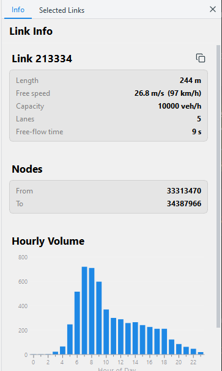

# Road links and hourly volume

## Examine a link

Click a road on the map. The road shows in yellow. The **Info** page of the
side panel shows:

- The link ID. Click the copy button to copy it.
- The length, free speed, capacity, number of lanes, road type and free-flow
  time.
- The from node and the to node.
- The **Hourly Volume** chart.

## Read the hourly volume chart

Each bar shows the number of vehicles that entered the link in one hour of
the day (0 to 23). Point to a bar to see its hour and its value.

- Trips after 24:00 count in the hours of the next day. For example, 25:30
  counts in hour 1.
- Before you load counts, the bars show the simulated vehicles from the
  events file. These numbers are not scaled to the full population.
- After you load counts, TAREEK-Vis multiplies the bars by the
  `countsScaleFactor` that you gave. See
  [Compare with traffic counts](counts.md).
- Just after a run opens, TAREEK-Vis counts the volumes in the background.
  The chart shows when this is complete.

## Export the chart

1. Click **Export chart...** below the chart, or right-click the chart.
2. Type a file name that ends in `.png` or `.pdf`.

The title of the chart shows the link ID and the name of the run folder. The
file name that TAREEK-Vis suggests is `<run>_link_<link ID>`.

## Compare a link in two runs

1. Click the link in the first run.
2. Open the second run, for example a scenario run.

The same link opens again in the second run. TAREEK-Vis finds it by its ID.
If the second run does not have the link, the status bar tells you.
