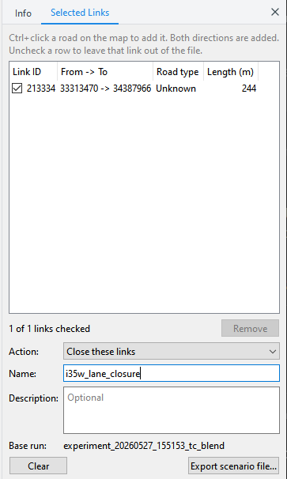

# What-if scenarios

A what-if scenario closes roads to cars. TAREEK-Vis makes the scenario file.
TAREEK then runs the baseline again with these roads closed.

## Make a scenario file

1. Open the output folder of the baseline run.
2. Ctrl+click a road on the map. TAREEK-Vis adds both directions of the road
   to the **Selected Links** page of the side panel. The selected links show
   in red on the map.
3. Do step 2 again for each road that you want to close. To remove a road,
   Ctrl+click it again.
4. To keep a link out of the file, clear its check box. For example, do this
   to close only one direction.
5. Type a **Name**. Use only letters, digits, `_` and `-`.
6. If you want, type a **Description**.
7. Make sure that **Base run** shows the name of the baseline folder. If you
   opened `experiments/<id>/output`, it shows `<id>`.
8. Click **Export scenario file...** and save the file.



If the export button does not work, the panel tells you why.

## Change the list

- To remove rows, select them and click **Remove**, or press Delete.
- To remove all rows, click **Clear**, or click **Scenario > Clear
  Selection**.
- Double-click a row to zoom to that link.
- When you open a different run, the list is cleared.

## The scenario file

The file contains only the links that have a check mark:

```json
{
  "name": "hwy15_bridge_closure",
  "description": "Full closure of the Hwy 15 bridge, both directions",
  "base_experiment": "experiment_20261012_101500",
  "closures": [
    { "type": "close", "link_ids": ["48211", "48212"] }
  ]
}
```

To run it in TAREEK:

```
python run_scenario.py run --base <baseline folder> --scenario hwy15_bridge_closure.json
```

To compare the two runs, see [Road links and hourly volume](road-links.md).
