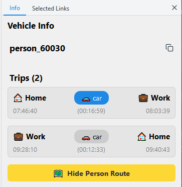

# Vehicles and persons

## Show or hide vehicles

Use the **View > Vehicles** group:

| Button | Shows |
|--------|-------|
| All Vehicles | All vehicles. Turn it off to hide all of them. |
| Private | Private vehicles (cars). |
| Bus | Buses. |
| Tram | Trams. |
| Rail | Trains. |
| Other Modes | A list of the other modes in the run, for example aircraft, taxis or bikes, with the number of vehicles. Clear a mode to hide its vehicles. |

TAREEK-Vis finds the mode of a vehicle in this order:

1. The transit schedule gives the buses, trams and trains.
2. The leg mode of the driver's trip gives the other modes. For example, the
   leg mode `uam` gives an aircraft, `taxi` gives a taxi and `bike` gives a
   bike.
3. A vehicle that starts on an air link is an aircraft.
4. All other vehicles are cars.

## Change how vehicles look

Use the **View > Vehicle Style** group:

| Button | Choices |
|--------|---------|
| Shape | Auto (by mode), Circle, Triangle (Arrow), Rectangle, Diamond. Auto is the default. With Auto, aircraft show as an aircraft symbol. |
| Size | Small (3 px), Medium (5 px), Large (8 px). Large is the default. |
| Color | By Speed (the default) or By Mode (icons). |

With **By Speed**, the color shows the speed of the vehicle as a part of the
free speed of its link:

| Speed | Color |
|-------|-------|
| 80% to 100% of free speed | Green |
| 40% to 80% | Green to yellow |
| Less than 40% | Yellow to red |

## Examine a vehicle

Click a vehicle. A halo shows on the vehicle and the map follows it. The
**Info** page of the side panel shows:

- The mode of the vehicle, for example Car, Bus or Aircraft.
- For a car or an aircraft: the ID of the driver and the trips of the driver
  for the day.
- For a bus, tram or train: the line, the route and the passengers aboard
  now. Click a passenger to see the day of that person.

Each trip shows the activity at the start, the mode, the activity at the
end, the departure time, the duration and the arrival time. The trip in
progress has a highlight. "stuck" means that the person did not arrive.

To stop following the vehicle, click an empty area of the map. The Info page
keeps the vehicle.

To copy an ID, click the copy button beside it.

## See the route of a person

- Click **Show Person Route**. The route of the full day shows on the map in
  yellow, with a marker at each activity.
- Click a trip to show only that trip. Click the trip again to hide it.
- Click **Hide Person Route** to remove the route.

To find a person by their ID, see
[Find a link, person or vehicle](find.md).
